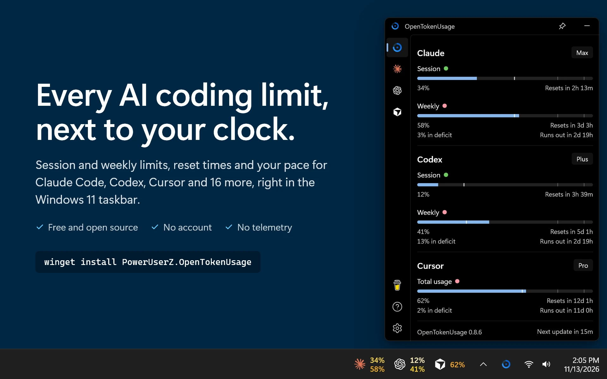
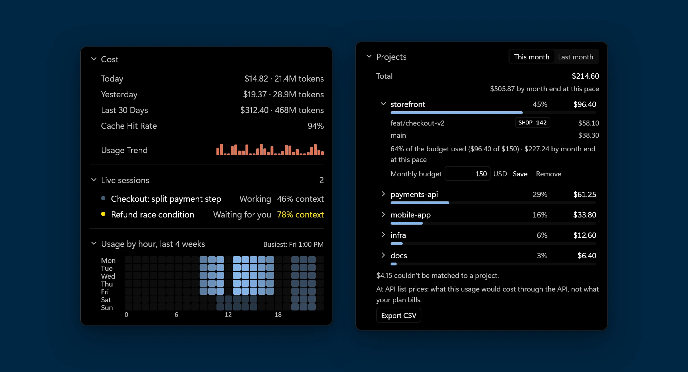
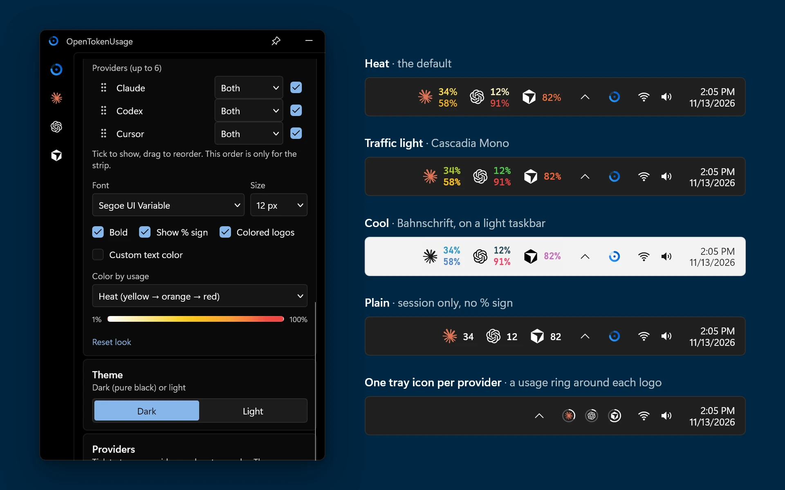
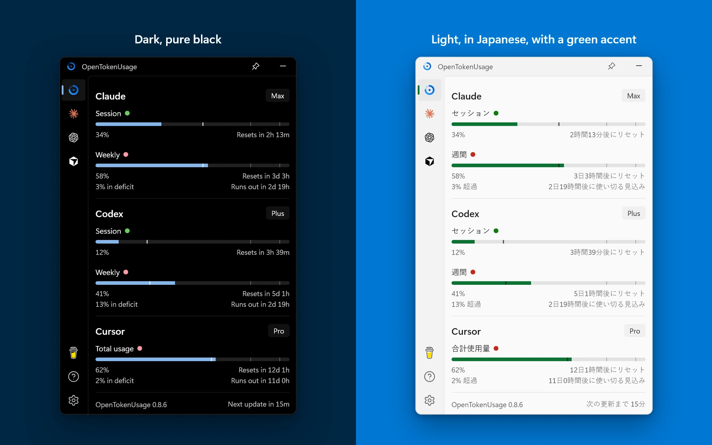

<div align="center">


# OpenTokenUsage

A free, open-source Windows&nbsp;11 tray app that tracks your limits<br>
on Claude Code, Codex, Cursor, Copilot and 15 more AI coding tools.

[](https://github.com/PowerUserZ/OpenTokenUsage/releases/latest)
[](https://github.com/PowerUserZ/OpenTokenUsage/releases)
[](LICENSE)
[](https://opentokenusage.app)

[Download](https://github.com/PowerUserZ/OpenTokenUsage/releases/latest) · [Website](https://opentokenusage.app) · [Changelog](CHANGELOG.md) · [Report a problem](https://github.com/PowerUserZ/OpenTokenUsage/issues/new)

</div>



OpenTokenUsage sits in the notification area and reads your usage with the sign-in each tool already keeps on your PC. No API keys to paste for Claude or Codex, no dashboards to dig through, no mental math: one glance shows how much is left, when it resets, and whether it lasts until then.

## Install

**With [WinGet](https://learn.microsoft.com/windows/package-manager/winget/) (recommended):**

```powershell
winget install PowerUserZ.OpenTokenUsage
```

Or [**download the latest release**](https://github.com/PowerUserZ/OpenTokenUsage/releases/latest) and run `OpenTokenUsage_<version>_x64-setup.exe`.

Either way it installs for your Windows user only (`%LOCALAPPDATA%\OpenTokenUsage`), so neither the install nor updates ask for admin rights. The app checks for new versions every 15 minutes and updates itself when you click **Restart to update**. On first start it turns on the providers you're signed in to.

> [!NOTE]
> The installer isn't code-signed, so a setup downloaded in the browser gets a Microsoft Defender SmartScreen warning ("Windows protected your PC", unknown publisher): choose **More info** → **Run anyway** (newer Windows shows **Run anyway** right away). WinGet checks the installer against its manifest's hash and shows no warning, and neither do the in-app updates.

**Installed 0.7.7 or earlier (MSI or WinGet)?** Use the in-app update once. It moves the app to the per-user install and asks for admin once, to remove the old per-machine copy. Your settings stay. Until then, `winget upgrade` says the install technology is different.

## Is it safe?

- **Open source, built in public.** Since 0.6.24, every installer is built by [GitHub Actions](.github/workflows/publish.yml) from this repository's tagged commit, not on a personal PC.
- **Official downloads only:** [GitHub Releases](https://github.com/PowerUserZ/OpenTokenUsage/releases), WinGet (`PowerUserZ.OpenTokenUsage`) and [opentokenusage.app](https://opentokenusage.app), which links to the releases. A copy from anywhere else isn't ours.
- **Check your download.** The release page lists each file's SHA-256. Compare it with:

  ```powershell
  Get-FileHash .\OpenTokenUsage_<version>_x64-setup.exe
  ```

- **Releases can't be changed.** From 0.8.7 on, releases are immutable: once published, a release's files and tag are locked, so a download can't be swapped later. GitHub also keeps signed records for each setup, filed under its SHA-256 (nothing is added to the file itself). With the [GitHub CLI](https://cli.github.com/):

  ```powershell
  # The file is the one published in that release:
  gh release verify-asset v<version> .\OpenTokenUsage_<version>_x64-setup.exe -R PowerUserZ/OpenTokenUsage
  # It was built by this repository's release workflow:
  gh attestation verify .\OpenTokenUsage_<version>_x64-setup.exe -R PowerUserZ/OpenTokenUsage `
    --signer-workflow poweruserz/OpenTokenUsage/.github/workflows/publish.yml
  ```

- **Signed updates.** The app installs an update only if it's signed with the release key whose public half is built into the app.
- **Your data stays on your PC.** No telemetry, no account, no server of its own. See [Privacy](#privacy).
- **Found a security problem?** Report it privately, as [SECURITY.md](SECURITY.md) describes.

## What It Does

- **One glance.** All your AI tools in one panel, opened from the tray or a global shortcut. Pin it above other windows, or have it open where you left it.
- **Next to the clock.** The tray shows the app icon, a percent, bars, or one number or logo ring per provider.
- **Taskbar strip (experimental).** Provider logos with session and weekly usage right in the taskbar, in your own fonts, colors and order, on one monitor or all of them.
- **Pace.** Every limit says whether you're ahead or behind, and when it runs out at this rate. A weekly limit's pace can count work days only.
- **Since you last looked.** When the panel opens, what you used while it was closed blinks hatched, then the bar fills over it.
- **Notifications.** At the usage levels you pick, for every provider or each on its own (the bars show a notch at each level), when you're on pace to run out before a reset, when a limit resets, and when a Claude or Codex session uses tokens far faster than usual (often an agent stuck in a loop), with a built-in sound or your own.
- **Banked resets.** Codex and Claude reset counts, what each one clears, its expiry date and a live countdown, with reminders 7 days and 24 hours before.
- **One-click fixes.** Errors come with the fix: run the login command in a terminal, or open the provider's API key page and Windows' Environment Variables. A Claude or Codex card that lost its sign-in refreshes the moment you sign in again.
- **Service status.** A badge on the card when the provider's status page reports an incident.
- **More than one login.** A second Claude or Codex account gets its own card, and so does a different login inside a running WSL distro.
- **Plugin-based.** Each provider is a small plugin, so adding one is easy. New providers arrive with app updates.
- **[Local HTTP API](docs/local-http-api.md).** Other apps on your PC can read your usage from `127.0.0.1:6736` (loopback only).
- **[Proxy support](docs/proxy.md).** Route provider requests through a SOCKS5 or HTTP proxy.

## See Where Your Tokens Go



Open Claude or Codex for its detail page. It adds what only their own logs on your PC can tell, and none of it leaves the PC:

- **Usage by project.** Each repository's share of the month, or of the current weekly limit, and its cost at API prices, with its git branches and any ticket key in the branch name.
- **Monthly budgets.** A project's bar turns yellow at 80% and red at 100%, with a notification at each, even with the panel closed.
- **Export CSV** of the month, one row per branch, and costs in **one of 13 currencies** at a rate you enter.
- **Weekly limit by day.** What each day of the current weekly limit used of it, so far.
- **Usage by hour.** Tokens per weekday and hour over the last 4 weeks, with your busiest hour and each weekday's total.
- **Live sessions.** The Claude Code sessions running on this PC and what each is doing; with the Claude Code status line on, how full each context is.
- **Cache hit rate** and a 30-day usage trend.

Costs come from [ccusage](https://github.com/ryoppippi/ccusage), which runs through Bun or Node.js. Without either, the lists show tokens.

## Make It Yours



Settings → **Tray icon** picks what sits next to the clock. Settings → **Taskbar strip** puts logos with session and weekly numbers into the taskbar: choose up to 6 providers and their order, the font and size, and a color scale that warms up as you use more.

**Right** keeps the strip beside the notification area. The other choice follows how Windows aligns the taskbar icons: **Left** (the taskbar's left edge) when they are centered, **Center** when they are aligned left. The strip measures the Start, Widgets, app and tray buttons and stays in the free space next to them, so it never covers one; with no free space wide enough, it hides. **Offset (px)** adds spacing (0–4096, scaled with the display). The default stays Right with an 8 px offset, and the placement applies to every selected taskbar.

## At Home on Windows 11



- **Mica and your accent color.** The panel takes Windows' backdrop and your accent color.
- **Dark and light.** A pure black dark theme and a light one. Tray icons and the strip follow the taskbar's theme the moment it changes.
- **11 languages.** English, Deutsch, Español (España and Latinoamérica), Français, Italiano, 日本語, 한국어, Português (Brasil), Türkçe and 简体中文.
- **Settings backup.** Export your settings to a file and import them on another PC. Logins stay where they are.

## Smart Refresh

Settings → **Auto refresh → Smart** paces each account on its own: every 2 minutes while its usage moves, then 5, 10 and finally 15 minutes while it stays the same. Claude cards wait at least 10 minutes between checks: Anthropic allows about 30 usage reads an hour per login, shared with Claude Code and other monitors. Fixed intervals, 15 minutes by default, stay available.

<details>
<summary>How it schedules</summary>

Checks are scheduled after results arrive, so a slow account does not overlap itself or block another account. Failures use a separate 2/5/10/15-minute backoff, and the HTTP rate-limit gate still enforces server retry delays, also after the app restarts. Opening the panel refreshes data at least a minute old, without bypassing error backoff. At the 15-minute cadence, usage elsewhere can take up to 15 minutes to be detected.

Smart polls reuse successful local token-history scans for up to 15 minutes; manual refreshes and fixed intervals still scan fresh history. Quota checks remain live. Only raw progress values and limits determine activity, so countdown text and history charts cannot keep an idle account polling rapidly.

</details>

## Supported Providers

- [**Amp**](docs/providers/amp.md) / free tier, bonus, credits
- [**Antigravity**](docs/providers/antigravity.md) / Gemini and Claude models, session and weekly
- [**Claude**](docs/providers/claude.md) / session, weekly, Fable, extra usage, rate limit resets, local token usage (ccusage)
- [**Codex**](docs/providers/codex.md) / session, weekly, reviews, credits, banked resets with expiry countdowns
- [**Copilot**](docs/providers/copilot.md) / credits, extra usage, chat, completions
- [**Cursor**](docs/providers/cursor.md) / credits, total usage, requests, auto usage, API usage, Grok Bot, on-demand, bonus spend, CLI auth
- [**DeepSeek**](docs/providers/deepseek.md) / API balance
- [**Devin**](docs/providers/devin.md) / weekly and daily quota, extra usage
- [**Factory / Droid**](docs/providers/factory.md) / standard, premium tokens
- [**Grok**](docs/providers/grok.md) / weekly limit, credits used, pay-as-you-go cap
- [**JetBrains AI Assistant**](docs/providers/jetbrains-ai-assistant.md) / quota, remaining
- [**Kimi Code**](docs/providers/kimi.md) / session, weekly
- [**Kiro**](docs/providers/kiro.md) / credits, bonus credits, overages
- [**MiniMax**](docs/providers/minimax.md) / coding plan session
- [**Muse Code**](docs/providers/muse.md) / session, weekly (turn it on in Settings)
- [**OpenCode Go**](docs/providers/opencode-go.md) / 5h, weekly, monthly usage limits
- [**OpenRouter**](docs/providers/openrouter.md) / credits, API key spending cap, daily and monthly spend
- [**Synthetic**](docs/providers/synthetic.md) / 5-hour rate limit, subscription, tool calls, search
- [**Z.ai**](docs/providers/zai.md) / session, weekly, web searches

## Privacy

This program will not transfer any information to other networked systems unless specifically requested by the user or the person installing or operating it.

OpenTokenUsage has no telemetry, no analytics and no server of its own. It connects only to:

- **The AI providers you use,** with the sign-in already on your computer, to read your usage and to refresh that sign-in when it expires. Each provider receives only its own credentials.
- **GitHub** (`api.github.com`, `github.com`), to check for updates and show the changelog.
- **Provider status pages** (for example `status.claude.com`), for the status badge.
- **The npm registry, through your own package manager:** when Bun, pnpm or npm is installed, the Claude and Codex cards run [ccusage](https://github.com/ryoppippi/ccusage) to total local token usage, and the package manager may download it the first time.

Settings and cached usage stay on your computer (`%APPDATA%\com.poweruserz.opentokenusage`). The local HTTP API listens on `127.0.0.1` only.

## Contributing

- **Add a provider.** Each one is just a plugin. See the [Plugin API](docs/plugins/api.md).
- **Fix a bug.** PRs welcome. Provide before/after screenshots.
- **Request a feature.** [Open an issue](https://github.com/PowerUserZ/OpenTokenUsage/issues/new) and make your case.

## Support

OpenTokenUsage is free and made by one person. If it saves you time, you can buy me a coffee, or star the repository so others find it.

<a href="https://www.buymeacoffee.com/PowerUserZ" target="_blank"></a>

## License

[MIT](LICENSE)

---

<details>
<summary><strong>Build from source</strong></summary>

### Prerequisites

- [Rust](https://www.rust-lang.org/tools/install)
- [Bun](https://bun.sh)
- [Tauri 2 prerequisites](https://v2.tauri.app/start/prerequisites/)

### Steps

```bash
git clone https://github.com/PowerUserZ/OpenTokenUsage.git
cd OpenTokenUsage
bun install
bun tauri build
```

The built app will be in `src-tauri/target/release/bundle/`.

</details>

## Acknowledgments

OpenTokenUsage started as a fork of [OpenUsage](https://github.com/robinebers/openusage) by [Robin Ebers](https://itsbyrob.in/x) (MIT) and was rebuilt for Windows. It is not the official OpenUsage and is not affiliated with it. Inspired by [CodexBar](https://github.com/steipete/CodexBar) by [@steipete](https://github.com/steipete).
